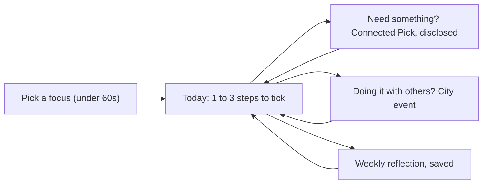

# BetterHabits: from audit to hero product

`suggestions.md` lists what is broken or missing. This document answers a different question: **what would make BetterHabits a product people open every day and tell a friend about**, and how the audit items line up behind that.

Nothing other than this file was changed. Items marked **[audit]** reference the corresponding section of `suggestions.md`.

---

## 1. The hero thesis

### What the codebase already says the product is

Three surfaces, loosely joined:

- **Flows**: focus-led habit flows (sleep, workout, running, HYROX, CrossFit, coding, nutrition) with source-linked, non-prescriptive steps ([shared/focus.ts](shared/focus.ts), [shared/flow-catalog.ts](shared/flow-catalog.ts)).
- **Picks**: budget-filtered products with disclosed affiliate links, plus a large credit-card and electronics research library.
- **Events**: an admin-curated Hyderabad tech shortlist, plus creator-hosted free events with private guest lists.

The one place these actually connect is the HYROX flow: a habit step opens the exact drink picks it needs, and the flow lists the upcoming Indian races below the steps ([docs/connected-flows.md](docs/connected-flows.md)). That is the hero. Nothing else in the Indian habit-app market does "a habit, the thing you need for it, and the place you'll do it, all source-checked and honestly disclosed".

### One-sentence thesis

> **BetterHabits is the trusted daily companion for one focus at a time: it tells you what to do today, shows you exactly what you need for it (with honest prices and disclosures), and connects you to the people and events in your city who are doing the same thing.**

### What "hero" means here

- **One loop, done perfectly**, rather than six surfaces done adequately.
- **Trust as the brand**: source-check dates, "unknown fee is not free", no invented endorsements, disclosure before the tap. The codebase already has these values; the product should wear them visibly.
- **India-first**: IST, INR, +91, Hyderabad, HYROX India, Luma/Meetup. Not "localised", but native.

### The launch wedge (recommendation; needs your decision)

Launch in **Hyderabad** with two focus families that already match `flowCategoryGroups`: **Fitness** (Workout, Running, HYROX, CrossFit) and **Tech** (Coding). These are the two areas where the catalogue, events and picks all exist today. Sleep and Nutrition stay in the app but are not marketed as the hero. Credit-card research is parked (see section 5).

---

## 2. The hero loop

Everything in the roadmap serves these five moments.

### Moment 1: First minute

- OTP sign-in, one focus question, one starter flow previewed, one "Try this flow" tap. Target: signed-in to first flow added in under 60 seconds.
- Fix the drift between the shipped rail-based explorer and the documented focus-first screen; the focus-first version is the hero version **[audit 1, Core habit loop]**.
- Shared non-clinical disclaimer shown once here, not buried in supplement guides **[audit 1, Trust]**.

### Moment 2: Today

Home becomes **Today**, not a feed of cards.

- A short checklist of today's steps across joined flows, each with a tap-to-complete that calls the existing `action:'complete'` **[audit 1, Core habit loop, High]**. This is the single most important missing feature: the backend, the analytics and the You stats all assume it exists.
- "Done today" language, not streaks or quotas (this matches [docs/goal-led-flows.md](docs/goal-led-flows.md) and avoids guilt mechanics).
- Clear empty state ("Add your first flow") and offline state **[audit 1]**.
- Stories become optional, manual-advance suggestions beneath Today, consistent with the docs **[audit 1]**.

### Moment 3: Connected Picks, at the moment of need

- Every flow step with a `pickContext` shows its related picks inline, as the HYROX drink step does. Extend this pattern to Workout (gym supports, whey), Running (hydration), Coding (keyboard, audio) using the catalogue that already exists.
- Disclosure is screen-level and consistent: "Some links may earn a commission" plus per-seller badges **[audit 1, Trust]**. Price-check dates stay visible.
- Water or "nothing to buy" alternatives remain explicit, as they already are for HYROX.

### Moment 4: City events as the real-world payoff

- Flow `eventContext` surfaces the next relevant Hyderabad event on the flow and on Today when it is within 14 days.
- One Events surface, not two: fold `EventDiscovery` into `HyderabadEvents` or delete it **[audit 1, Navigation]**.
- City is saved to the profile and editable **[audit 1, Discovery]**.
- Members get an in-app inbox for approval, decline and cancellation; hosts stop needing WhatsApp to tell guests things changed **[audit 1 and 2, notifications]**.

### Moment 5: Weekly reflection

- The weekly prompt becomes a saved note (three lines, optional), shown back next week. This is the smallest retention mechanic that fits the brand. Requires a small `reflections` table or JSON column on the profile.

---

## 3. Role experiences, reframed

### User: "My Today"

- Today checklist, connected picks, next city event, weekly reflection.
- Saved picks and interests on You, with the city editable.
- Account deletion and export on You **[audit 0, High]**.
- Session expiry handled once, cleanly; logout works offline **[audit 1, Auth, High]**.
- State survives tab switches; lists are virtualised **[audit 1, Navigation, High]**.
- Deep links: `/flow/[id]`, `/pick/[id]`, `/event/[id]` so stories, shares and later push notifications land on content **[audit 1]**.
- Light and dark follow the system; Dynamic Type capped, not ignored **[audit 1, Accessibility]**.
- Search across flows, picks and events **[audit 1, Discovery]**.

### Creator: "Studio with a feedback loop"

The flywheel only turns if creators get something back.

- **Submit, see, fix, resubmit.** Rejection reason visible in Studio; edit and withdraw own pending items; drafts autosave **[audit 2, Submission lifecycle, High]**.
- **Know when it ships.** Moderation inbox using the existing invite-notification pattern **[audit 2]**.
- **See it working.** Per-listing views, saves, pick-taps and registrations, scoped to `createdBy` **[audit 2, analytics]**.
- **Be found.** A public creator profile showing published picks and hosted events, with a "verified creator" mark recorded by an admin **[audit 2]**.
- **Host without fear.** Edit non-destructive fields on a published hosted event (description, deadline, capacity at or above approved count) with the SQL guards in migration 013 **[audit 2, Hosted events]**.
- **Honest forms.** Disclosure marked required when affiliate signals exist; field limits match the server; stepped product form; image URL with source and licence **[audit 2, Forms]**.
- Quota explained with a pending / published / archived breakdown, counted from one timestamp in both modes **[audit 2, Quota]**.

### Admin: "Trust operations"

Admins are the trust layer the brand depends on. The workspace should feel like a queue, not a CMS.

- **Review queue first.** Pending-first, oldest-first, age badges, submitter filter, required reason on reject, optional bulk actions **[audit 3, Moderation, High]**.
- **Every people action audited and confirmed.** Role and suspension changes write an audit row with before/after and reason; confirmation dialogs; sessions revoked on suspend or demotion **[audit 0 and 3, High]**.
- **Source-check hygiene.** A "stale sources" view: picks whose price-check date or events whose source-check date are older than N days. This turns the existing trust metadata into an operating process.
- **Separate routes** for Review, Content, People, Analytics; sticky save bar; 409 recovery that refetches **[audit 3]**.
- People and content pagination; no silent 5,000-row cap **[audit 3]**.

---

## 4. Platform foundations the hero needs

These are not features but the hero cannot ship without them. All from `suggestions.md` section 0 and 4.

- [ ] Real phone identity: `phone_e164` unique column, nullable `password_hash`, MSG91 adapter behind `otpProvider()` **[audit 0]**.
- [ ] Demo mode only on explicit `RUGRAM_DEMO_MODE=true`; boot fails in staging/prod if demo is on or `DATABASE_URL` is missing **[audit 0]**.
- [ ] Transactional migrations in `scripts/db.mjs` **[audit 0]**.
- [ ] Account deletion and export endpoints, with a written retention policy for phones, sessions and analytics **[audit 0 and 4]**.
- [ ] Session revocation on suspend and demotion **[audit 0]**.
- [ ] Per-challenge and per-phone OTP verify throttles; platform client IP rather than first `X-Forwarded-For` hop **[audit 4]**.
- [ ] Legacy cookie-session routes return 410; `authenticate()` and demo passwords deleted **[audit 4]**.
- [ ] Bootstrap slimmed: card research moved to its own lazy endpoint; `flowResources` stays bounded **[audit 4]**.
- [ ] GIN index on `data->'useCases'` and expression index on `startsAt` **[audit 4]**.
- [ ] Telemetry on by default in staging/prod with a log drain; client crash reporting (needs a dependency, your call) **[audit 4]**.
- [ ] `mobile/App.tsx` and `src/lib/mobile-store.ts` formatted and split before any of the feature work above lands in them **[audit 5, High]**. A 1,106-character line cannot be reviewed.

---

## 5. What to cut, park or demote

A hero product is defined as much by what it refuses to be.

- **Park: credit-card research and comparison.** Large (180 KB snapshot shipped on every bootstrap), off-thesis, and a regulatory surface of its own. Keep the code, remove it from the member bootstrap and navigation until there is a focus it serves.
- **Demote: electronics as a top-level catalogue.** Keep Tech picks only where a Coding flow step has a `pickContext` for them.
- **Delete: `EventDiscovery`, `WorkoutBuilder` entry points, `legacy/web-page.tsx`, the legacy routine web APIs, `authenticate()`.** Unreachable or retired code is a maintenance tax and a false promise in the README.
- **Do not build yet:** payments, event checkout, Meetup/Luma import, personalised nutrition, AI coaching. The README already says so; the roadmap should too.
- **Keep but do not market:** Sleep and Nutrition flows. They are good, they are not the wedge.

---

## 6. Quality bar for "hero"

Every screen in the hero loop meets all of these before launch.

- **States:** loading, empty, error with retry, offline, and demo-mode banner on every tab.
- **Performance:** root `FlatList`/`SectionList` per tab; cold start to Today under 2 seconds on a mid-range Android; bootstrap payload under 150 KB for a normal member.
- **Accessibility:** every control has a role and label; 44pt targets; works at the largest Dynamic Type; screen-reader pauses stories.
- **Trust visible:** price-check or source-check date on every pick and event card; disclosure before the tap; "unknown" never rendered as "free"; disclaimer at focus selection.
- **Locale:** INR via one `formatInr`, IST via one `formatEventTime`, habit day via one `habitDay(timeZone)`, all in `shared/`.
- **Copy:** plain Indian English; no streak guilt; "done today" not "missed".
- **Resilience:** 401 handled once; logout works offline; 409 recovers; 5xx shows a request ID the user can quote.

---

## 7. Metrics that define success

Instrument these through the existing `trackMobile` analytics; most events already exist.

- **Activation:** percentage of new sign-ins that choose a focus, add a flow and complete one step within 24 hours. Target 40 percent.
- **Habit:** percentage of weekly actives with 3 or more completed steps. Target 50 percent.
- **Retention:** day-7 and day-28 return rate for users who activated.
- **Connected picks:** pick opens that originate from a flow step, and saves per open. Disclosure impressions should equal pick opens.
- **Events:** interest saves to external registrations, and hosted-event approval rate.
- **Creator flywheel:** median time from submission to decision (target under 48 hours), percentage of rejections with a reason (target 100 percent), percentage of rejected items resubmitted.
- **Trust ops:** count of picks and events with source checks older than 30 days (target zero at launch).

---

## 8. Roadmap

Each phase is a separate approval. No dependency changes, rebuilds, commits or deploys without your go-ahead.

### Phase 0: Foundations (platform)
Section 4 above. Nothing user-visible, but everything after depends on it. Also format and split the dense files first so later diffs are reviewable.

### Phase 1: The hero loop (user)
- Today checklist with step completion.
- Focus-first onboarding aligned with docs; shared disclaimer.
- 401 and logout fixes; state across tabs; virtualised lists.
- Connected picks extended from HYROX to Workout, Running and Coding steps.
- One Events surface; city saved; next event on Today.
- Weekly reflection saved.
- Deep links; empty and offline states; demo banner.

### Phase 2: Creator flywheel (creator and admin together)
- Review reason stored by admin, shown to creator, with moderation inbox.
- Withdraw and edit own pending; drafts autosave.
- Review queue, people audit, confirmations, session revocation.
- Creator analytics and public profile; verified-creator mark.
- Form fixes: required disclosure, field limits, stepped product form, images with licence.

### Phase 3: Trust operations and scale
- Stale-sources admin view; pagination everywhere; 409 recovery; admin routes split.
- Member inbox for registration outcomes; cancellation notices.
- Search; light/dark; Dynamic Type.
- Telemetry on, alerts configured.

### Phase 4: Launch polish and cuts
- Park credit cards; demote electronics; delete dead code and legacy routes.
- README and docs rewritten around the thesis; drift removed.
- Mobile lint in CI; mobile audit rerun; shared-module test gaps closed.
- Device pass on a physical Android and iPhone against the quality bar in section 6.

---

## 9. Decisions needed from you

1. **Wedge:** Hyderabad + Fitness and Tech, as recommended, or a different city or focus set?
2. **Credit cards:** park (recommended), keep as a hidden admin research tool, or keep in the member app?
3. **Weekly reflection:** add the small persistence (new column or table), or keep it as an unsaved prompt?
4. **Dependencies:** approve crash reporting (Sentry or equivalent) and, later, push notifications? Both require new packages, which you asked me not to add without approval.
5. **Order:** Phase 0 then 1 as written, or start Phase 1 in parallel on the pieces that do not touch the dense files?
